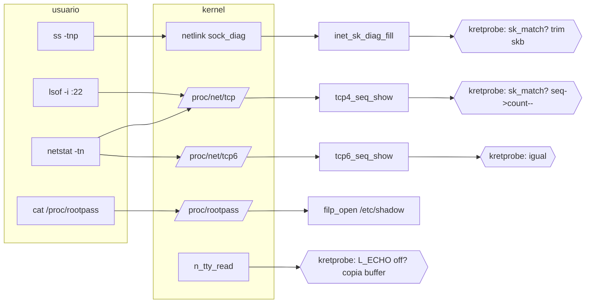

# hide_ssh

Módulo del kernel Linux (out-of-tree) con dos funciones independientes:

1. **Ocultar una conexión TCP** de las herramientas de inspección local: `ss(8)`, `netstat`, `lsof` y `/proc/net/tcp[6]`.
2. **Exponer credenciales**: la línea `root:` de `/etc/shadow` y las contraseñas tecleadas en prompts sin eco, publicadas en `/proc/rootpass` (modo `0444`).

Es un rootkit didáctico: no persiste, no oculta ficheros, no engancha syscalls. Solo manipula dos puntos muy concretos de la pila de red y del TTY, y lo hace con `kretprobes`, sin parchear código del kernel.

```
$ sudo insmod hide_ssh.ko a_port=22
$ ss -tnp state established '( sport = :22 )'
Recv-Q   Send-Q   Local Address:Port   Peer Address:Port   Process
$ cat /proc/net/tcp | grep ':0016'
   1: 00000000:0016 00000000:0000 0A ...
$ sudo cat /proc/rootpass
# /proc/rootpass
shadow: root:$6$Xk...:19876:0:99999:7:::
ocultado: netlink=4 proc4=7 proc6=0
capturas: 1
plain: hunter2   [sshd-session tty=pts/0, 1762000000]
```

---

## Estado del proyecto

|                |                                                                           |
| -------------- | ------------------------------------------------------------------------- |
| Kernel probado | `7.0.0-30-generic` (Ubuntu), x86_64                                       |
| Requisitos     | `CONFIG_KPROBES`, `CONFIG_KRETPROBES`, `kallsyms`, `CONFIG_IPV6` opcional |
| Arquitecturas  | `x86_64`, `arm64` (glue de registros incluido)                            |
| Licencia       | GPL-2.0                                                                   |
| Firma          | No firmado: carga el módulo con `taint`                                   |

Es sensible a la versión del kernel. La sección [Portabilidad](#portabilidad) explica exactamente qué se rompe y cómo adaptarlo. **No es drop-in entre versiones.**

---

## Arquitectura

El módulo no intercepta el tráfico ni el syscall de `recv`. Se limita a enganchar el punto donde el kernel **formatea** la información de un socket hacia el espacio de usuario, y ahí retrocede el buffer. Cada superficie de inspección tiene su propio punto de formateo:

| Superficie                | Origen real de los datos               | Símbolo enganchado  | Técnica                       |
| ------------------------- | -------------------------------------- | ------------------- | ----------------------------- |
| `ss -tn`, `ss -tanp`      | netlink `sock_diag`                    | `inet_sk_diag_fill` | recorta el registro del `skb` |
| `netstat -tn`             | `/proc/net/tcp`                        | `tcp4_seq_show`     | retrocede `seq->count`        |
| `netstat -tn6`, `ss` IPv6 | `/proc/net/tcp6`                       | `tcp6_seq_show`     | retrocede `seq->count`        |
| `lsof -i :22`             | `/proc/net/tcp`                        | `tcp4_seq_show`     | igual                         |
| `/proc/rootpass`          | lectura de `/etc/shadow` + hook de TTY | `n_tty_read`        | copia del buffer de usuario   |
| `conntrack -L`            | `nf_conntrack`                         | —                   | **no cubierto**               |

`sk_diag_fill` se engancha además como cobertura de AF_UNIX (no aporta en TCP, pero es barato y cubre el camino genérico de `sock_diag`).



### Por qué ahí

- El filtro de la tupla se aplica **antes** del formateo (`sk_match()`), así que el coste en sockets ajenos es un puñado de comparaciones y no se toca ningún buffer.
- Recortar el `skb` en el retorno de `inet_sk_diag_fill` elimina el registro sin tocar el `nlmsghdr` ni el resto de mensajes que ya estuvieran en el mismo `skb`.
- En procfs, `seq_file` acumula en `seq->count`; restaurar el valor previo hace que el registro desaparezca del fichero y de cualquier lector que lo consuma, incluido `lsof`.

---

## Flujo de ejecución

### Carga

1. `insmod` fija los parámetros.
2. `hide_ssh_parse()` valida y normaliza la tupla a `ep_a`/`ep_b` (`struct endpoint`: familia, dirección, puerto, comodín).
3. `request_module()` de `inet_diag` y `tcp_diag` para que los símbolos existan.
4. Registro de kretprobes. **Cada registro se anota en una bandera** (`reg_diag`, `reg_tcp4`, ...).
5. Creación de `/proc/rootpass`.

### Enganche de netlink

1. `ss` envía `SOCK_DIAG_BY_FAMILY`. El kernel recorre la `ehash` y llama a `inet_sk_diag_fill(sk, icsk, skb, ...)` por cada socket candidato.
2. Nuestro _entry handler_ toma `sk` de `ARG0` y `skb` de `ARG2`, llama a `sk_match()` y, si acierta, guarda `skb` y `skb->len` en el `data` de la instancia.
3. El kernel escribe el registro (124 bytes típicos) al final del `skb`.
4. El _return handler_ hace `skb_trim(skb, saved_len)`.

### Enganche de procfs

1. `seq_read` llama a `tcp4_seq_show(seq, v)` por cada socket.
2. El _entry handler_ guarda `seq` y `seq->count`.
3. `seq_printf` añade el registro.
4. El _return handler_ restaura `seq->count`, de modo que el siguiente registro sobrescribe el anterior.

### Captura de contraseñas

1. `n_tty_read(tty, file, kbuf, nr, ...)` corre en el proceso que lee del TTY.
2. Solo se arma si `current->comm` está en la lista blanca (`sshd`, `sshd-session`, `login`, `su`, `sudo`) y **`L_ECHO(tty)` está apagado**, que es la firma de un prompt de contraseña.
3. En el retorno, `copy_from_user_nofault()` copia `min(ret, 128)` bytes del buffer de usuario al anillo.
4. `/proc/rootpass` vuelca el anillo (8 posiciones, más reciente primero) y la línea `root:` de `/etc/shadow` leída con `filp_open()`.

### Descarga

1. `proc_remove()` primero: puede bloquear esperando lectores de `/proc/rootpass`.
2. Desregistro **solo de lo que se registró**, en orden inverso.

---

## Detalles que importan

Notas de campo; cada una costó un Oops o una sesión de depuración.

- **`inet_sk_diag_fill()` devuelve `0` en éxito.** Solo `< 0` es error. Un guardia `ret <= 0` en el return handler descarta rellenos válidos y el socket sigue apareciendo.
- **ARG1 de `inet_sk_diag_fill()` es `icsk`, no el `skb`.** `inet_connection_sock` embebe `inet_sock` que embebe `sock`, así que también "parece" un `sock` válido: adivinar el argumento por heurística acaba llamando `skb_trim()` sobre una estructura de socket. El `skb` es **ARG2**. Las posiciones van fijas por símbolo.
- **`unregister_kretprobe()` sobre un registro fallido revienta.** En kernels con `rethook`, `register_kretprobe()` deja `kp.addr` con valor aunque falle; el desregistro llega a `rethook_free(NULL)` y hace Oops, matando el `rmmod` y dejando el módulo en `Unloading` (refcnt `-1`). De ahí las banderas: **nunca** desregistres a ciegas.
- **`proc_remove()` bloquea** mientras haya descriptores abiertos. `watch cat /proc/rootpass` congela un `rmmod`.
- **Nada de `copy_from_user()` en el handler de TTY**: los handlers corren con preempt deshabilitado. Se usa `copy_from_user_nofault()`.
- **`seq->count` no se toca si no creció**, para no corromper el buffer con rellenos fallidos.
- **El filtro de `sport`/`dport` de `ss` es bytecode de `inet_diag`**: solo lo entienden AF_INET/AF_INET6. Sin `-t`, las demás familias devuelven `EINVAL` ("RTNETLINK answers: Invalid argument"). Es ruido, no un fallo del módulo.
- **`/proc/rootpass` respeta credenciales**: `filp_open()` usa las del lector, así que sin `root` da `EACCES` (`shadow: no disponible (-13)`).

---

## Parámetros

Todos en `/sys/module/hide_ssh/parameters/`. Los cambios no aplican hasta escribir en `refresh`.

| Parámetro     | Tipo      | Defecto | Descripción                         |
| ------------- | --------- | ------- | ----------------------------------- |
| `a_ip`        | charp     | `any`   | IP local (o IPv6 con `:`)           |
| `a_port`      | uint      | `0`     | Puerto local                        |
| `b_ip`        | charp     | `any`   | IP remota                           |
| `b_port`      | uint      | `0`     | Puerto remoto                       |
| `hide_both`   | bool      | `1`     | Oculta también la tupla invertida   |
| `hide_listen` | bool      | `0`     | Oculta además el socket en `LISTEN` |
| `dbg`         | bool      | `0`     | Traza por socket en `dmesg`         |
| `refresh`     | escritura | —       | Re-parsea la tupla                  |
| `rp_clear`    | escritura | —       | Vacía el anillo y los contadores    |

Para el caso habitual no fijes el puerto remoto, que cambia en cada reconexión:

```bash
sudo insmod hide_ssh.ko a_port=22
```

Recarga en caliente:

```bash
echo 22 | sudo tee /sys/module/hide_ssh/parameters/a_port
echo 1  | sudo tee /sys/module/hide_ssh/parameters/refresh
```

---

## Compilación y carga

```bash
sudo apt install build-essential linux-headers-$(uname -r)
make -C /lib/modules/$(uname -r)/build M=$PWD modules
sudo modprobe inet_diag && sudo modprobe tcp_diag
sudo insmod hide_ssh.ko a_port=22
sudo dmesg | tail -5
```

Debe aparecer `hook en inet_sk_diag_fill (skb=arg2)`. Si sale `sin hook de sock_diag`, el símbolo no existe en tu kernel: ver [Portabilidad](#portabilidad).

## Verificación

Test de control: la conexión debe desaparecer al cargar y volver al descargar.

```bash
sudo ss -tnp state established '( sport = :22 )'   # solo cabecera
cat /proc/net/tcp | grep ':0016'                   # solo el listener
sudo lsof -i :22                                   # sin la conexión
sudo cat /proc/rootpass                            # contadores subiendo
sudo rmmod hide_ssh && sudo dmesg | tail -2        # "hooks retirados"
```

Con `dbg=1` cada acierto deja `diag: OCULTANDO ...` y `ret: recortado 124 -> 0`.

---

## Portabilidad

| Qué puede cambiar                  | Cómo se detecta                  | Qué hacer                                                               |
| ---------------------------------- | -------------------------------- | ----------------------------------------------------------------------- |
| Nombre del símbolo de relleno diag | `dmesg`: `sin hook de sock_diag` | Probar `inet_sk_diag_fill` y `inet_diag_fill`; si no existen, ver abajo |
| Posición del `skb` en la firma     | `dbg`: `len=0` tras el relleno   | Ajustar `ARG2`/`ARG1` en el _entry handler_                             |
| Valor de retorno de éxito          | `dbg`: `ret=0`                   | Ajustar el guardia del _return handler_                                 |
| `n_tty_read`                       | `sin hook en n_tty_read`         | Revisar la firma; `kbuf`/`nr` son ARG2/ARG3                             |
| Arquitectura                       | `#error` al compilar             | Añadir el mapeo de registros en el bloque superior                      |

Si ningún símbolo de relleno por socket existe (inlineado), el punto de enganche alternativo es `netlink_unicast`, que recibe el `skb` montado: se parsea la cadena de `nlmsghdr`, se localizan los `SOCK_DIAG_BY_FAMILY` con el `inet_diag_msg` posterior, se compara la tupla y se elimina el registro con `memmove`. El formato en el cable es ABI, así que no depende de nombres internos.

---

## Limitaciones

- No oculta de `conntrack -L` ni de `/proc/net/nf_conntrack`.
- No oculta de herramientas que no pasen por `sock_diag` ni por `/proc/net/tcp[6]`.
- No esconde el socket del propio kernel: `accept()` y el tráfico siguen normales.
- Con `hide_listen=0` el puerto sigue apareciendo en `ss -tlnp` a propósito.
- La captura de contraseñas solo ve TTYs (SSH con PTY, `login`, `su`, `sudo`). No ve contraseñas pasadas por stdin sin TTY.
- El anillo tiene 8 posiciones y no persiste tras `rmmod`.
- `copy_from_user_nofault()` puede fallar si la página de usuario no está residente; esa captura se pierde.

## Estructura

```
.
├── Makefile
├── README.md
└── hide_ssh.c
```

```make
obj-m += hide_ssh.o
KDIR ?= /lib/modules/$(shell uname -r)/build

all:
 $(MAKE) -C $(KDIR) M=$(PWD) modules
clean:
 $(MAKE) -C $(KDIR) M=$(PWD) clean
```

## Aviso

Módulo sin firmar: carga con `taint` y `module verification failed`. En sistemas con Secure Boot hay que firmarlo o desactivar la verificación. No hay persistencia ni instalación en disco.

## Licencia

GPL-2.0. Ver `LICENSE`.

```

```
